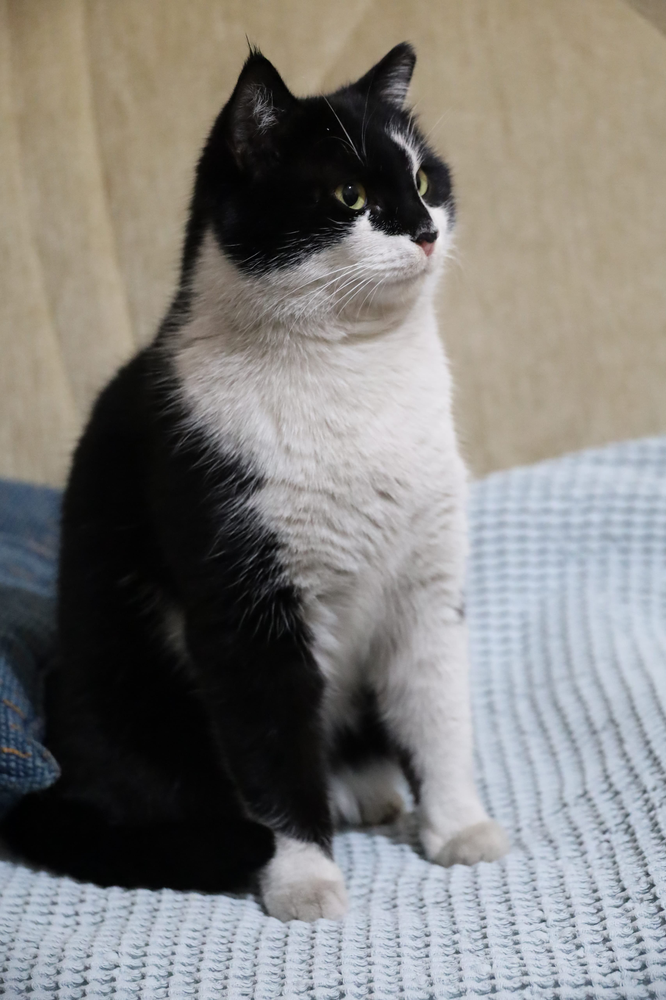

# AI-ML-90-Day-Journey 🚀

90 Days from Zero to Deploying Deep Learning Models

## Day 90 - Final Project: ResNet18 ONNX Live API

Built a production-ready Image Classification API.

**Live Proof - Siamese Cat Prediction:**
- Model: ResNet18 (PyTorch) -> Converted to ONNX
- API: FastAPI + Uvicorn + Swagger UI
- Test: Uploaded Siamese cat image -> Predicted correctly ✅

```json
{
  "prediction": "Siamese cat",
  "class_id": 284
}
*Endpoints:*
- `GET /health` - Health check
- `POST /predict` - Upload image -> returns prediction
- `GET /docs` - Swagger Documentation (http://127.0.0.1:8000/docs)

*Tech Stack:*
Python, PyTorch, ONNX Runtime, FastAPI, TorchVision, Pillow

*How to Run:*
.\venv\Scripts\activate
python 03-advanced/app/main.py
# Open http://127.0.0.1:8000/docs
## Journey Structure
- `01-basics/` - Python, Pandas, Numpy
- `02-ml/` - Scikit-Learn, Models
- `03-advanced/` - PyTorch, ONNX, FastAPI Deployment

---
*Completed:* 13 Oct 2026 | 90 Days Challenge DONE 🎓
"Live Proof":
   ``
